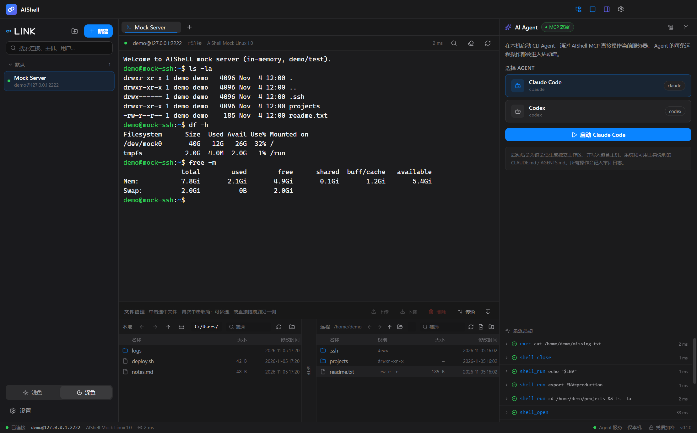
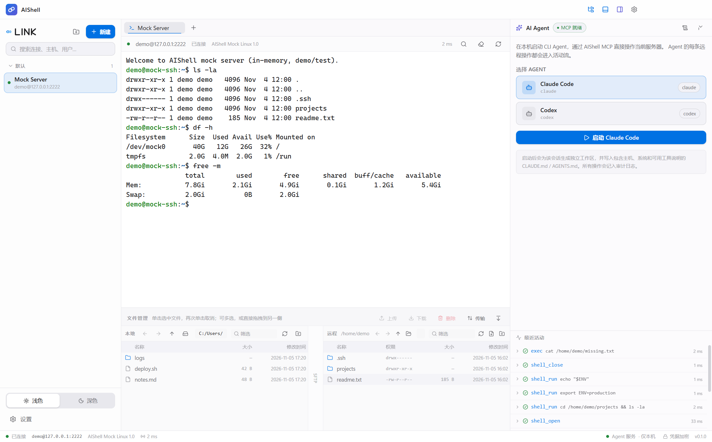
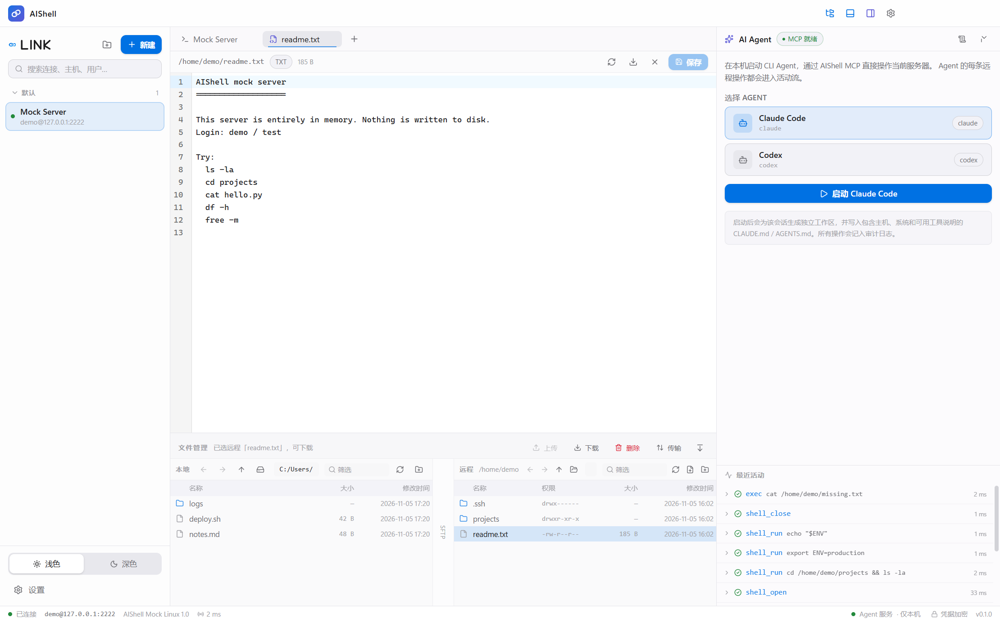
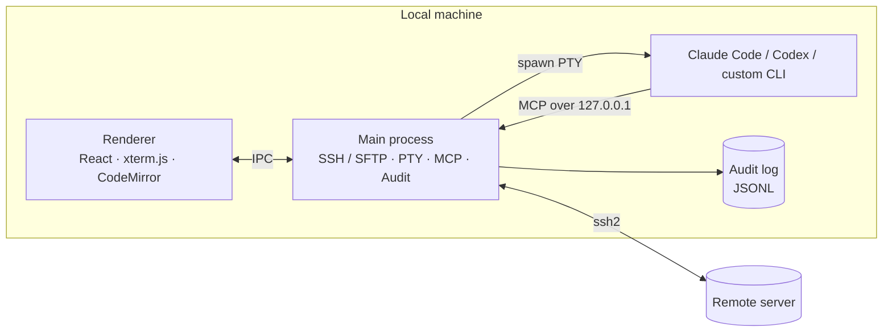
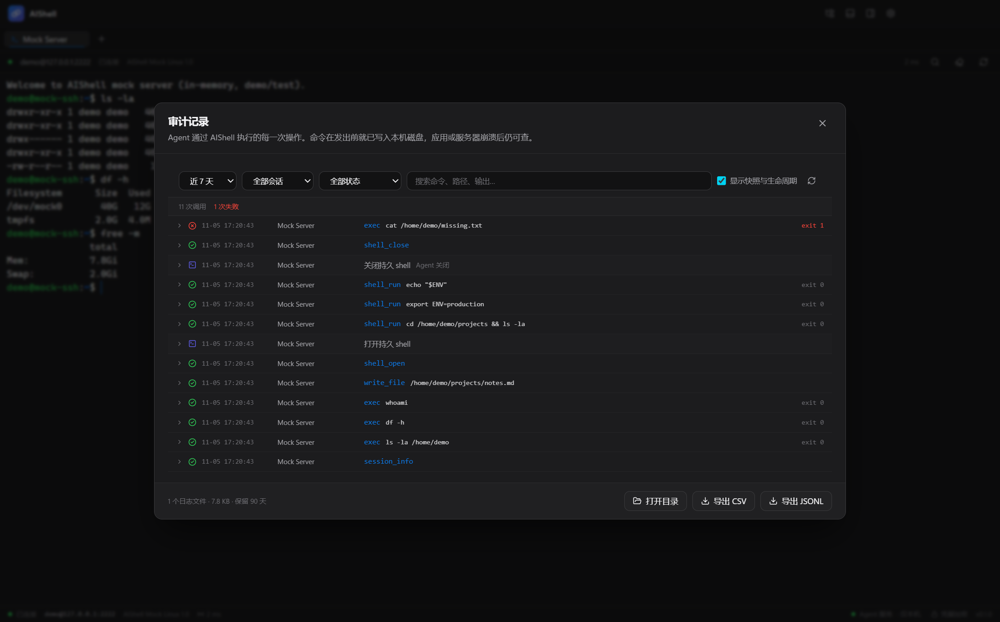

<div align="center">


# AIShell

**An AI-native SSH workbench**

Terminal, dual-pane SFTP and local CLI agents in one window

[](LICENSE)
[](#known-limitations)
[](https://www.electronjs.org/)
[](https://nodejs.org/)

[中文](README.md) · [Docs](docs/README.md) · [Verification](docs/verification.md)

</div>



## Why AIShell

Working on a remote server usually means three windows: an SSH client, an SFTP client, and a local terminal running Claude Code. AIShell puts them in one place:

- Sessions on the left, the terminal in the middle, local ⇄ remote file panes below;
- The agent on the right works inside the **session you are already connected to**, instead of pretending to reach the server from your laptop;
- Every remote tool call is written to a local audit log **before** it executes.

> **Design stance**: AIShell is a remote access channel plus an operation log, not a sandbox. Whether a command is dangerous is the agent's own decision. AIShell does not block or prompt; it guarantees that you can later answer "what ran, where, when, and how it ended."

## Features

| | |
|---|---|
| **Sessions** | Create / edit / delete / group / search / recent; password, private key and SSH agent auth; TOFU host fingerprint on first connect |
| **Terminal** | xterm.js 6 with tabs, search, copy/paste, font settings, reconnect and live latency |
| **Files** | Dual-pane local ⇄ remote browser; navigation, sorting, create, rename, delete; upload/download with progress and recursive directory transfer |
| **Remote editing** | Open remote text files in CodeMirror 6 and save back; unsaved changes are confirmed before closing |
| **Agent workspace** | Launch Claude Code / Codex / a custom CLI in a local PTY; workspace, context files and MCP config are generated automatically |
| **Persistent shell** | A per-session shell for the agent that keeps `cd`, `export` and virtualenv state; long jobs can be read later or interrupted with Ctrl+C |
| **Audit log** | Record-only; intents are persisted before execution, JSONL rolls daily, crashed calls are marked unfinished |
| **Activity feed** | Live view of MCP calls with tool name, arguments, duration and result |
| **Themes** | Dark and light |



## Quick start

### Run from source

Requires **Node.js 20.19+** (Vite 7 minimum) on Windows 10/11.

```bash
npm install
npm run dev
```

`node-pty` ships N-API prebuilds, so a local compiler toolchain is usually not needed.

### Build a Windows installer

```bash
npm run build:win
# output: release/AIShell-<version>-setup.exe
```

### Try it with the bundled fake server

The repo includes an in-memory SSH/SFTP server; no real host required:

```bash
npm run mock:ssh
```

Create a session in AIShell:

| Host | Port | User | Password |
|---|---|---|---|
| `127.0.0.1` | `2222` | `demo` | `test` |

The filesystem lives in memory and resets on restart.

## Usage

1. **Connect**: click **New** in the sidebar, fill in the host, then double-click the session. The host fingerprint is recorded on first connect; a changed fingerprint is rejected.
2. **Terminal**: multiple tabs; `Ctrl+F` to search, `Ctrl+Shift+C / V` to copy and paste.
3. **Files**: select files on either side and click upload / download, or drag them across. Double-click a remote text file to edit it.
4. **Agent**: pick Claude Code or Codex in the right panel and launch it. The workspace is generated and the agent reaches the server over MCP.
5. **Audit**: open **Audit log** from the agent panel or settings; filter by date, session, status or text, then export JSONL / CSV.

| Shortcut | Action |
|---|---|
| `Ctrl+Shift+B` | Toggle the session sidebar |
| `Ctrl+Shift+J` | Toggle the file panes |
| `Ctrl+Shift+A` | Toggle the agent panel |
| `Ctrl+,` | Open settings |
| `Ctrl+F` | Search the terminal |
| `Ctrl+Shift+C / V` | Terminal copy / paste |



## Architecture



AIShell never calls a model API itself: the agent is the CLI already installed on your machine, using its own credentials and network. AIShell only owns the process, the workspace and the MCP channel. See [docs/architecture.md](docs/architecture.md) for the process model, call flow and agent bootstrap.

## MCP tools

The MCP server binds to `127.0.0.1`, generates a random Bearer token at startup, and exposes a scoped endpoint per SSH session.

| Tool | Purpose | Kind |
|---|---|---|
| `session_info` / `list_sessions` | Read session and connection info | read-only |
| `exec` | Run a remote command in a fresh shell | write |
| `write_file` | Overwrite a remote file, with an `.aishell.bak` backup by default | write |
| `upload` / `download` | Transfer files; downloads are restricted to the agent workspace or the system Downloads folder | write |
| `shell_open` | Open the persistent shell (one per session, reused if already open) | write |
| `shell_run` | Run in the persistent shell, keeping `cwd` and environment | write |
| `shell_read` | Continue reading a command that is still running | read-only |
| `shell_interrupt` | Send Ctrl+C | write |
| `shell_close` | Close the persistent shell | write |

Every call follows **write intent → execute → write result**. If the intent cannot be written, the tool refuses to run, so nothing reaches the server without an audit record.

> Use `exec` for one-off commands. For work that needs `cd`, exported variables, a virtualenv, or long-running builds / deploys / `tail -f`, call `shell_open` first and then `shell_run`.

## Audit log



- **Location**: `%APPDATA%\aishell\audit\YYYY-MM-DD.jsonl` (`userData/audit/` on macOS and Linux), rolling by local date, append-only.
- **Contents**: an `intent` before execution, a `result` after it (status, duration, exit code, truncated output and sha256), plus `note` records for snapshots, agent lifecycle, persistent shells and local hooks.
- **Crash evidence**: an intent without a result is shown as unfinished once it crosses a day boundary or a 60-second grace period.
- **Query and export**: filter by date, session (including deleted sessions), status and full text; export JSONL or CSV with a UTF-8 BOM.
- **Retention**: 90 days by default; configurable to 30 / 90 / 180 days or forever. A warning is raised above 200 MB, but logs are never deleted automatically.
- **Redaction**: `mysql -pXXX`, `--password=`, `token=`, Bearer tokens and `sshpass -p` are replaced with `***` before hitting disk.
- **Legacy logs**: older builds wrote an approval `decision` field; it is still readable, but current builds no longer produce it.

See [docs/audit-and-persistent-shell.md](docs/audit-and-persistent-shell.md) for the design and trade-offs.

## Security model

| Boundary | Implementation |
|---|---|
| Local-only MCP | Listens on a random port on `127.0.0.1` |
| Authentication | A fresh 32-byte random Bearer token per launch |
| Session scope | The URL is bound to a `<sessionId>`; cross-session calls are flagged in the audit log |
| Credentials | Passwords and key passphrases encrypted with `safeStorage` (Windows DPAPI); memory-only if secure storage is unavailable |
| Host verification | SHA256 fingerprint recorded on first connect (TOFU); changed fingerprints are rejected |
| Redaction | Password / token parameters are replaced with `***` before persistence |
| Download target | MCP `download` may only write inside the agent workspace or the system Downloads folder |

**Explicit boundary**: an agent can bypass MCP and run `ssh` / `scp` / `sftp` locally. The Claude Code PreToolUse hook records those commands as `bash` notes, but that depends on the agent type and can only record, not prevent. Always describe the guarantee as "operations through AIShell are fully audited," never "everything is audited."

## Development

```bash
npm run dev          # development
npm run typecheck    # type-check main, renderer and test scripts
npm run build        # build into out/
npm run build:win    # type-check + build + NSIS installer
npm test             # unit + integration tests (spawns mock SSH, no Electron)
```

### MCP smoke test

Start the app and the mock server, then read the port and token from the app log:

```bash
# [mcp] listening on 127.0.0.1:<port> token=<token>
AISHELL_MCP_URL=http://127.0.0.1:<port>/mcp/<sessionId> \
AISHELL_MCP_TOKEN=<token> node scripts/mcp-smoke.mjs

# also exercise write_file / the persistent shell
AISHELL_MCP_URL=... AISHELL_MCP_TOKEN=... node scripts/mcp-smoke.mjs write
AISHELL_MCP_URL=... AISHELL_MCP_TOKEN=... node scripts/mcp-smoke.mjs shell
```

In PowerShell, set `$env:AISHELL_MCP_URL="..."` and `$env:AISHELL_MCP_TOKEN="..."` first.

### Persistent shell tests

<details>
<summary>Sentinel protocol tests against the mock SSH server and local bash</summary>

`test-agent-shell` / `test-ssh-manager` start the mock server on a free port
themselves; start one manually and pass `MOCK_SSH_PORT` to reuse it:

```bash
MOCK_SSH_PORT=2299 node tests/mock-ssh-server.mjs &

npm run test:agent-shell   # prefix with MOCK_SSH_PORT=2299 to reuse the server
npm run test:ssh           # SshManager: connect, exec, shell, timeout, disconnect
npm run test:agent-shell-bash
```

</details>

### UI automation

`scripts/aishell-cdp.mjs` is a minimal Chrome DevTools Protocol driver. Start the app with `--remote-debugging-port=9222`:

```bash
node scripts/aishell-cdp.mjs text
node scripts/aishell-cdp.mjs click-text "新建"
node scripts/aishell-cdp.mjs shot docs/images/app.png
```

## Project layout

```
src/
├─ main/          SSH/SFTP, PTY, agents, MCP server, audit, session store
├─ preload/       contextBridge allow-list API
├─ renderer/      React UI (sessions, terminal, files, agent, settings)
└─ shared/        types shared by main and renderer
tests/            unit/integration tests, mock SSH server, manual probes
scripts/          MCP smoke, CDP driver, icon and screenshot tools
docs/             architecture, audit design, verification, screenshots, design mockups
build/            app icons and packaging resources
```

## Known limitations

- Only the **Windows x64** installer is configured; development on other platforms is unverified.
- No port forwarding, jump hosts, directory sync or session recording yet.
- The persistent shell rejects interactive programs (`vim`, `less`, `top`, password-prompting `sudo`) and suggests non-interactive alternatives.
- An agent can bypass MCP with a local `ssh`; see [Security model](#security-model).
- Claude Code may ask you to trust the generated workspace on first launch (choose trust).
- Audit output stores truncated content plus hashes, not full large files.

## Roadmap

Multi-server / workspace model, port forwarding and jump hosts, broader local-command coverage across agents, and session recording. None of these are implemented; discuss priorities in an issue.

## Contributing

Issues and pull requests are welcome. Before submitting, run:

```bash
npm run typecheck
npm test
```

Changes touching audit or security boundaries should also update [docs/verification.md](docs/verification.md) and the relevant design document. Manual verification can be done entirely against the bundled mock SSH server.

## License

[MIT](LICENSE)
