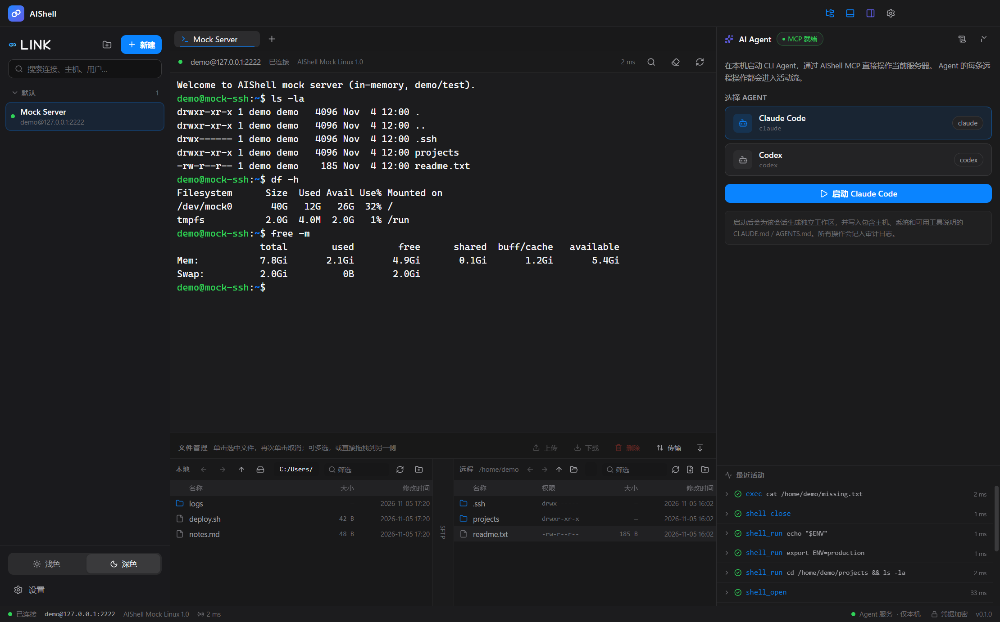
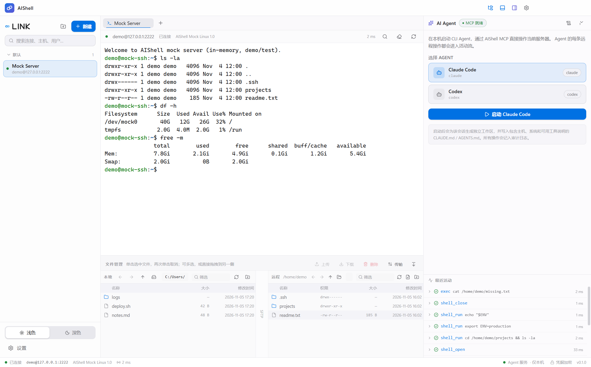
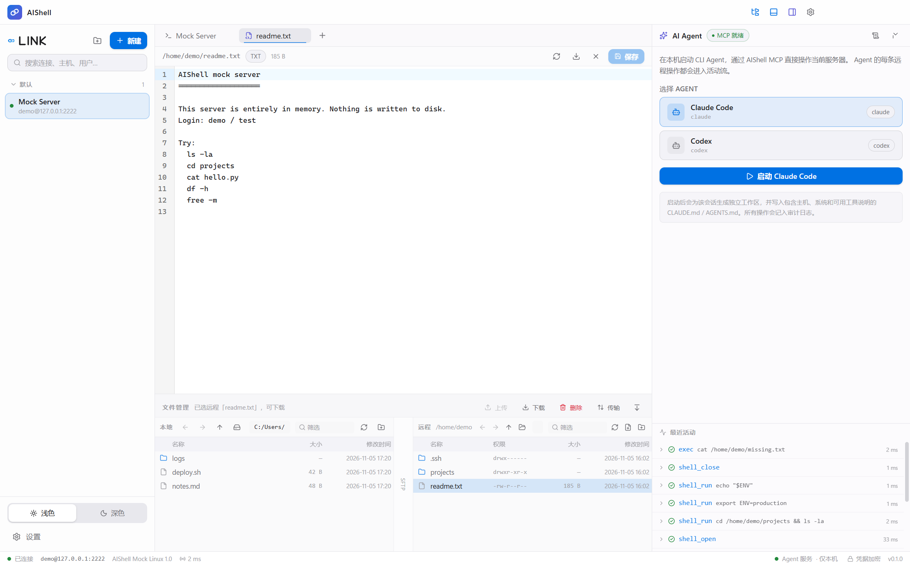
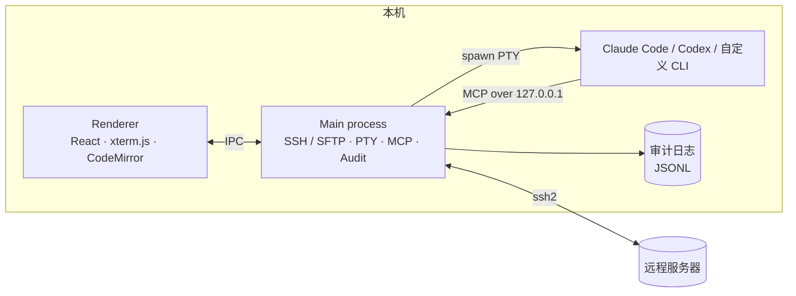
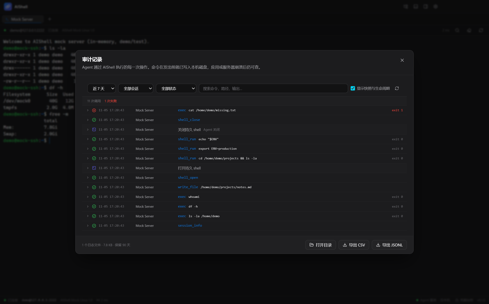

<div align="center">


# AIShell

**AI 原生的 SSH 工作台**

终端 · 双栏 SFTP · 本机 CLI Agent，在同一个窗口里操作远程服务器

[](LICENSE)
[](#已知限制)
[](https://www.electronjs.org/)
[](https://nodejs.org/)

[English](README.en.md) · [文档](docs/README.md) · [验证清单](docs/verification.md)

</div>



## 为什么是 AIShell

连服务器、传文件、跑 Claude Code，本来要开三个工具：SSH 客户端、SFTP 客户端，再加一个本地终端。AIShell 把它们放进同一个窗口：

- 左边是会话，中间是终端，下面是本地 ⇄ 远程双栏文件；
- 右边的 Agent 直接在你**当前已连接**的 SSH 会话里工作，而不是在本机假装连上了服务器；
- Agent 的每一次远程调用，都会在发出前写入本机审计日志。

> **设计立场**：AIShell 是「远程访问通道 + 操作记录」，不是安全沙箱。命令是否危险由 Agent 自身的策略判断，AIShell 不拦截、不询问，只保证「在什么时间、对哪台机器、执行了什么、结果如何」可以事后复查。

## 功能

| | |
|---|---|
| **会话管理** | 新建 / 编辑 / 删除 / 分组 / 搜索 / 最近使用；密码、私钥、SSH Agent 三种认证；首次连接 TOFU 指纹校验 |
| **终端** | xterm.js 6，多标签、搜索、复制粘贴、字体设置、断线重连、实时延迟 |
| **文件管理** | 本地 ⇄ 远程双栏，路径导航、排序、新建、重命名、删除；上传下载带进度，支持目录递归传输 |
| **远程编辑** | 双击远程文本文件用 CodeMirror 6 打开，保存写回服务器；未保存关闭会确认 |
| **Agent 工作台** | 在本机 PTY 启动 Claude Code / Codex / 自定义 CLI，自动生成工作区、上下文文件与 MCP 配置 |
| **持久 shell** | Agent 按会话打开独立 shell，`cd`、`export`、虚拟环境跨命令保持；长任务可继续读取、Ctrl+C 中断 |
| **审计记录** | record-only；调用发出前落盘，JSONL 按天滚动，崩溃后仍能定位「未完成」的调用 |
| **活动流** | MCP 工具调用实时显示工具名、参数、耗时和结果 |
| **主题** | 深色 / 浅色一键切换 |



## 快速开始

### 从源码运行

要求 **Node.js 20.19+**（Vite 7 的最低版本），Windows 10/11。

```bash
npm install
npm run dev
```

首次启动 `node-pty` 使用 N-API 预编译产物，通常不需要本地编译工具链。

### 打包 Windows 安装包

```bash
npm run build:win
# 输出：release/AIShell-<version>-setup.exe
```

### 用内置假服务器试用

仓库自带一个纯内存的 SSH/SFTP 服务器，不需要真实主机：

```bash
npm run mock:ssh
```

然后在 AIShell 中新建连接：

| 主机 | 端口 | 用户 | 密码 |
|---|---|---|---|
| `127.0.0.1` | `2222` | `demo` | `test` |

文件系统完全在内存中，重启即重置。

## 使用

1. **连接**：左侧「新建」填写主机信息，双击会话连接。首次连接会记录主机指纹，之后指纹变化将拒绝连接。
2. **终端**：支持多标签；`Ctrl+F` 搜索，`Ctrl+Shift+C / V` 复制粘贴。
3. **文件**：选中本地或远程文件后点上传 / 下载，也可以直接拖拽到另一侧。双击远程文本文件即可在线编辑。
4. **Agent**：右下角面板选择 Claude Code 或 Codex，点击启动。工作区会自动生成，Agent 通过 MCP 操作当前服务器。
5. **审计**：Agent 面板或设置页打开「审计记录」，按日期、会话、状态、文本筛选，导出 JSONL / CSV。

| 快捷键 | 功能 |
|---|---|
| `Ctrl+Shift+B` | 显示 / 隐藏连接栏 |
| `Ctrl+Shift+J` | 显示 / 隐藏文件面板 |
| `Ctrl+Shift+A` | 显示 / 隐藏 Agent 面板 |
| `Ctrl+,` | 打开设置 |
| `Ctrl+F` | 终端搜索 |
| `Ctrl+Shift+C / V` | 终端复制 / 粘贴 |



## 架构



AIShell 不调用任何模型 API：Agent 仍是你本机安装的 CLI，使用自己的凭据与网络。AIShell 只负责进程、工作区和 MCP 通道。更完整的进程模型、调用链与 Agent 启动流程见 [docs/architecture.md](docs/architecture.md)。

## MCP 工具

MCP Server 只监听 `127.0.0.1`，每次启动生成随机 Bearer Token，每个 SSH 会话有独立作用域地址。

| 工具 | 用途 | 类型 |
|---|---|---|
| `session_info` / `list_sessions` | 读取会话与连接信息 | 只读 |
| `exec` | 远程执行命令（每次都是新 shell） | 写 |
| `write_file` | 覆盖写入远程文件，默认先建 `.aishell.bak` 备份 | 写 |
| `upload` / `download` | 本机 ⇄ 远程传输；下载只能写到 Agent 工作区或系统下载目录 | 写 |
| `shell_open` | 打开持久 shell（每会话一条，已打开则复用） | 写 |
| `shell_run` | 在持久 shell 中执行命令，保留 `cwd` / 环境变量 | 写 |
| `shell_read` | 继续读取仍在运行的命令 | 只读 |
| `shell_interrupt` | 发送 Ctrl+C | 写 |
| `shell_close` | 关闭持久 shell | 写 |

调用流程：**先同步写 `intent`，再执行，最后写 `result`**。审计日志写不进去时，工具直接报错并拒绝执行，避免未审计的操作上服务器。

> `exec` 适合一次性命令；需要保持目录、环境变量、虚拟环境，或运行编译、部署、`tail -f` 这类长任务时，先 `shell_open`，再用 `shell_run`。

## 审计日志



- **位置**：`%APPDATA%\aishell\audit\YYYY-MM-DD.jsonl`（macOS / Linux 为 `userData/audit/`），按本地日期滚动，append-only。
- **内容**：每次调用的 `intent`（发出前）、`result`（状态、耗时、退出码、截断输出与 sha256），以及快照 / Agent 生命周期 / 持久 shell / 本机 hook 等 `note`。
- **崩溃现场**：只有 `intent` 没有 `result` 的调用显示为「未完成」，跨天或超过 60 秒宽限期即判定。
- **查询与导出**：按日期、会话（含已删除会话）、状态、全文搜索；导出 JSONL 或带 UTF-8 BOM 的 CSV。
- **留存**：默认 90 天，可在设置中改为 30 / 90 / 180 天或永久；目录超过 200 MB 时告警，不自动删除。
- **脱敏**：`mysql -pXXX`、`--password=`、`token=`、Bearer、`sshpass -p` 等模式在落盘前替换为 `***`。
- **历史日志**：早期版本写入过审批结果 `decision` 字段，仍可读取；当前版本不再产生。

设计细节与取舍见 [docs/audit-and-persistent-shell.md](docs/audit-and-persistent-shell.md)。

## 安全模型

| 边界 | 实现 |
|---|---|
| MCP 仅本机可访问 | 监听 `127.0.0.1` 的随机端口 |
| 调用认证 | 每次启动生成 32 字节随机 Bearer Token |
| 会话隔离 | URL 绑定 `<sessionId>`；跨会话调用会在审计中标记 |
| 凭据保护 | `safeStorage`（Windows DPAPI）加密密码与私钥口令；系统安全存储不可用时仅保存在内存 |
| 主机验证 | 首次连接记录 SHA256 指纹（TOFU），指纹变化拒绝连接 |
| 数据脱敏 | 密码 / Token 类参数落盘前替换为 `***` |
| 下载落点 | MCP `download` 只能写入 Agent 工作区或系统下载目录 |

**明确的边界**：Agent 可以绕过 MCP，在本机直接执行 `ssh` / `scp` / `sftp`。Claude Code 的 PreToolUse hook 会把这类命令补记为 `bash` note，但这依赖 Agent 类型，且只能记录、不能阻止。因此对外表述应始终是「通过 AIShell 的操作有完整审计」，而不是「完整审计」。

## 开发

```bash
npm run dev          # 开发模式
npm run typecheck    # 类型检查（node + web）
npm run build        # 构建 out/
npm run build:win    # 类型检查 + 构建 + NSIS 安装包
npm test             # AuditStore 单元测试（不需要 Electron）
```

### MCP 冒烟测试

先启动应用和 mock 服务器，再从应用日志中取端口与 Token：

```bash
# [mcp] listening on 127.0.0.1:<port> token=<token>
AISHELL_MCP_URL=http://127.0.0.1:<port>/mcp/<sessionId> \
AISHELL_MCP_TOKEN=<token> node scripts/mcp-smoke.mjs

# 额外测试文件写入 / 持久 shell
AISHELL_MCP_URL=... AISHELL_MCP_TOKEN=... node scripts/mcp-smoke.mjs write
AISHELL_MCP_URL=... AISHELL_MCP_TOKEN=... node scripts/mcp-smoke.mjs shell
```

PowerShell 中请先 `$env:AISHELL_MCP_URL="..."`、`$env:AISHELL_MCP_TOKEN="..."`。

### 持久 shell 单元测试

<details>
<summary>针对 mock SSH 服务器和本地 bash 的哨兵协议测试</summary>

```bash
MOCK_SSH_PORT=2299 node scripts/mock-ssh-server.mjs &

npx esbuild scripts/test-agent-shell.mts --bundle --platform=node \
  --format=esm --external:ssh2 --outfile=scripts/.tmp-test.mjs
MOCK_SSH_PORT=2299 node scripts/.tmp-test.mjs

npx esbuild scripts/test-agent-shell-bash.mts --bundle --platform=node \
  --format=esm --external:ssh2 --outfile=scripts/.tmp-bash.mjs
node scripts/.tmp-bash.mjs
```

</details>

### UI 自动化

`scripts/aishell-cdp.mjs` 是一个基于 Chrome DevTools Protocol 的最小驱动脚本。应用需以 `--remote-debugging-port=9222` 启动：

```bash
node scripts/aishell-cdp.mjs text
node scripts/aishell-cdp.mjs click-text "新建"
node scripts/aishell-cdp.mjs shot docs/images/app.png
```

## 目录结构

```
src/
├─ main/          SSH/SFTP、PTY、Agent、MCP Server、审计、会话存储
├─ preload/       contextBridge 白名单 API
├─ renderer/      React 界面（会话栏、终端、文件、Agent、设置）
└─ shared/        主进程与渲染层共享类型
scripts/          mock SSH 服务、MCP 冒烟、单元测试、CDP 驱动、截图工具
docs/             架构、审计设计、验证清单、截图、设计稿
build/            应用图标与打包资源
```

## 已知限制

- 安装包目前只配置了 **Windows x64**；其他平台的开发运行未做验证。
- 暂不支持端口转发、跳板机、SFTP 目录同步、会话录制。
- 持久 shell 不支持交互式程序（`vim` / `less` / `top` / 需要输入密码的 `sudo`），会在发出前拒绝并给出替代方案。
- Agent 绕过 MCP 直接在本机执行 `ssh` 的行为无法完全拦截；见[安全模型](#安全模型)。
- 首次启动 Claude Code 时，可能要求确认工作区信任（选择信任即可）。
- 审计输出只保存截断后的内容与哈希，不保存完整大文件。

## 后续方向

多服务器 / 工作区模型、端口转发与跳板机、更多 Agent 的本地命令补记、会话录制。这些尚未实现，欢迎在 Issue 中讨论优先级。

## 贡献

欢迎 Issue 和 Pull Request。提交前请至少运行：

```bash
npm run typecheck
npm test
```

涉及审计、安全边界的改动，请同步更新 [docs/verification.md](docs/verification.md) 与相关设计文档。手动验证可以完全基于内置的 mock SSH 服务器完成。

## License

[MIT](LICENSE)
