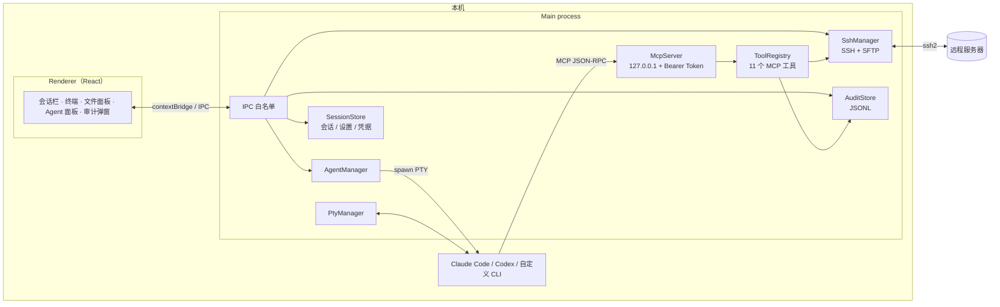
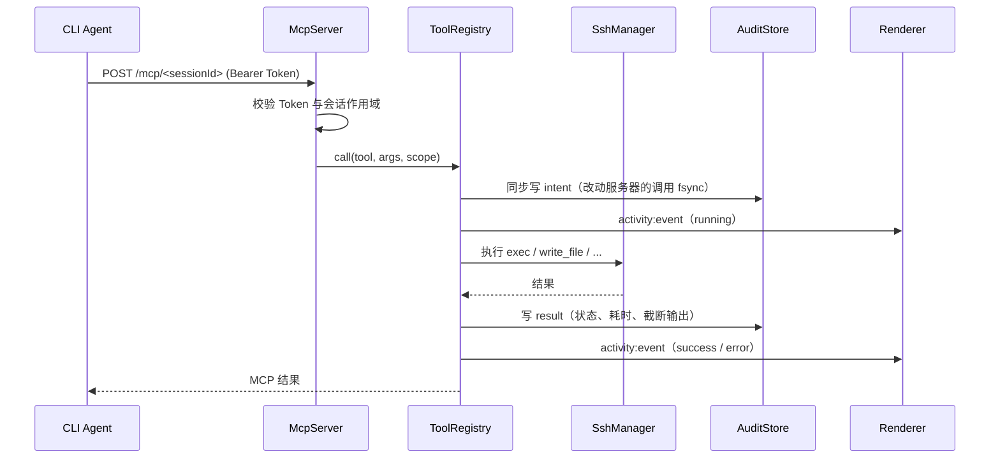

# 架构总览

AIShell 是一个 Electron 桌面应用：本机终端里的 CLI Agent（Claude Code / Codex / 自定义）通过 AIShell 内置的 MCP Server 操作 SSH 服务器，所有调用在执行前写入本机审计日志。每个 Agent 是一个独立窗口，拥有自己的 SSH 连接和 MCP 作用域；同一台服务器的窗口共用一个工作区（因此在 Claude Code 里属于同一个 project），可以并行运行。

## 1. 进程与模块



| 模块 | 职责 | 位置 |
|---|---|---|
| `SessionStore` | 会话、分组、设置、已知主机、凭据加密 | [src/main/store/SessionStore.ts](../src/main/store/SessionStore.ts) |
| `SshManager` | 连接、exec、SFTP、主机信息、Agent 持久 shell | [src/main/ssh/SshManager.ts](../src/main/ssh/SshManager.ts) |
| `AgentShell` | 独立于用户终端的持久 shell，随机哨兵判定命令结束 | [src/main/ssh/AgentShell.ts](../src/main/ssh/AgentShell.ts) |
| `PtyManager` | 本机伪终端：用户终端与 Agent 进程共用 | [src/main/pty/PtyManager.ts](../src/main/pty/PtyManager.ts) |
| `AgentManager` | 生成工作区、MCP 配置、启动脚本，管理 Agent 生命周期 | [src/main/agents/AgentManager.ts](../src/main/agents/AgentManager.ts) |
| `McpServer` | HTTP JSON-RPC、Token 校验、会话作用域、MCP 握手 | [src/main/mcp/server.ts](../src/main/mcp/server.ts) |
| `ToolRegistry` | 工具定义、执行、审计 intent/result、活动流 | [src/main/mcp/tools.ts](../src/main/mcp/tools.ts) |
| `AuditStore` | 按天 JSONL、崩溃检测、脱敏、留存清理、导出 | [src/main/audit/AuditStore.ts](../src/main/audit/AuditStore.ts) |
| Renderer | React 19 + Zustand + xterm.js + CodeMirror | [src/renderer/](../src/renderer/) |

## 2. 一次 MCP 调用的路径



关键点：

- **intent 先于执行**。即使命令执行中应用或服务器崩溃，事后仍能知道「发出了什么」；有 intent 无 result 的记录显示为「未完成」。
- **写失败则拒绝执行**。审计日志写不进去时，工具直接报错，不让未审计的操作上服务器。
- **AIShell 不拦截命令**。危险操作只打标签（`dangerous`）并记入审计，是否执行由 Agent 自身的策略决定。
- **活动流与审计分离**。活动流是内存中的实时视图；审计是磁盘上的历史记录，两者查询方式不同。

## 3. Agent 启动

每个 Agent 窗口由 `AgentManager` 创建，拥有独立的连接实例 `agent:<agentSessionId>`、MCP URL 和持久 shell。同一台服务器的所有窗口共用同一个工作区 `userData/workspaces/<sessionId>/`：Claude Code 按 cwd 划分 project，共用 cwd 就是共用 project 和对话历史。每个窗口自己的配置放在 `.aishell/agents/<agentSessionId>/`：

```
CLAUDE.md / AGENTS.md              远程服务器上下文、工具使用规则（窗口共用）
.claude/settings.json              PreToolUse hook：记录本机 ssh/scp/sftp（窗口共用）
.aishell/
  hook-bash.*                      hook 脚本（窗口共用，按进程环境变量归属窗口）
  agents/<agentSessionId>/
    claude-mcp.json                Claude Code 的 MCP 配置（含本次运行的 Token）
    session.json                   会话元数据
    README.md                      自定义 Agent 接入说明
    launch-<id>.cmd / .sh          PTY 启动脚本
    codex/                         隔离的 CODEX_HOME 与 MCP 配置（Codex）
```

- 共用工作区意味着各窗口的文件、`CLAUDE.md`、权限批准和 prompt 历史都共享；MCP 凭据与启动脚本仍然一窗一份，避免后启动的窗口覆盖先启动窗口的 Token。
- 新窗口启动时生成自己的 Claude session id（`--session-id <uuid>`），「继续」用 `--resume <id>`。共用 project 后 `--continue` 会挑「最近一次对话」，可能续到别的窗口上，因此不再使用；早期创建的窗口没有 session id，仍沿用 `--continue`（它们的工作区是独立的，不存在歧义）。
- 切换前创建的旧窗口保留原工作区路径，不受影响。

- **Claude Code**：`claude --mcp-config .aishell/claude-mcp.json`，可选 `--strict-mcp-config`。
- **Codex**：独立 `CODEX_HOME`，写入 `[mcp_servers.aishell]`，Token 由 `AISHELL_MCP_TOKEN` 传入。
- **自定义 Agent**：注入 `AISHELL_MCP_URL` / `AISHELL_MCP_TOKEN` / `AISHELL_SESSION_ID` / `AISHELL_WORKSPACE`。

Agent 运行在本机 PTY 中，不经过模型 API；AIShell 只负责进程、工作区和 MCP 通道。

窗口生命周期：

- MCP URL 携带 `?agent=<agentSessionId>&conn=<connId>`，工具调用因此绑定到这个窗口自己的连接，而不是某个终端标签。
- 关闭终端标签不会停止 Agent；关闭最后一个终端后，只要还有 Agent 窗口，服务器上下文和 Agent 面板都会保留。
- 停止 Agent 会终止其 PTY、断开自己的 SSH 连接并删除面板中的该窗口；最后一个窗口关闭后，Agent 面板回到「选择 Agent」界面。
- 停止、重试、重连都只影响这一个窗口；同一服务器的其他窗口继续运行。
- 每个窗口的记录写入 `userData/agent-windows.json`（退出应用时记为 `app_quit`）。再次打开该服务器时，「上次的窗口」会列出这些记录。
- 标签栏右侧的 + 打开的是同一个选择界面（上次的窗口 + 选择 Agent），而不是直接新建窗口：继续旧窗口和新建窗口是同一个入口。
- 面板里的窗口标签显示该窗口对话的标题：读取 transcript 里第一条用户消息（跳过斜杠命令和注入内容），新窗口在首轮对话后约 5 秒内更新；没有对话历史的窗口仍显示默认的「Claude Code #n」。
- 「继续」复用原工作区重新启动：Claude Code 追加 `--resume <session-id>`（早期窗口用 `--continue`），Codex 使用 `resume --last`，自定义 Agent 获得 `AISHELL_RESUME=1`。对话历史由 CLI 自己保存，AIShell 只负责复用同一个工作目录/`CODEX_HOME`；检测不到历史时退化为在同一工作区重新打开。
- 「删除」只移除记录、该窗口自己的文件（`.aishell/agents/<id>/`）和它的 Claude 对话记录；共用工作区里的文件和其他窗口的历史不受影响。
- 启动 Agent 时会剔除从父进程继承的 Claude Code 嵌套会话变量（`CLAUDE_CODE_CHILD_SESSION` 等），否则子进程会关闭 transcript 保存，导致无法恢复。
- 终端尺寸由渲染进程上报：终端挂载时（此时 Agent 可能仍是 `starting`）先记录尺寸，PTY 创建时直接按该尺寸启动，而不是固定 120×32。否则 CLI 会先按 120 列绘制，再被缩放到面板宽度，留下错位的画面。

## 4. 持久 shell

`exec` 每次都是新的 SSH 通道，不保留 `cd` / `export`。需要连续状态或长任务时，Agent 使用每个连接实例（每个 Agent 窗口）独立的持久 shell：

- 与用户终端**完全独立**，避免输出互相污染。
- 命令结束后追加随机哨兵（nonce + seq），不解析提示符，一次往返拿到退出码与 `$PWD`。
- 超时不杀命令，返回 `running=true`；`shell_read` 继续读取，`shell_interrupt` 发送 Ctrl+C。
- 不支持 `vim` / `less` / `top` 等交互式程序，发出前拒绝并给出替代方案。

完整设计见 [audit-and-persistent-shell.md](./audit-and-persistent-shell.md)。

## 5. 安全边界

| 边界 | 实现 |
|---|---|
| MCP 仅本机可访问 | 监听 `127.0.0.1` 随机端口 |
| 调用认证 | 每次启动随机生成 32 字节 Bearer Token |
| 会话隔离 | URL 绑定 `<sessionId>`；跨会话调用会在审计中标记 |
| 凭据 | `safeStorage`（Windows DPAPI）加密密码与私钥口令；不可用时仅内存保存 |
| 主机验证 | 首次连接记录 SHA256 指纹（TOFU），后续变化拒绝连接 |
| 审计脱敏 | `-pXXX`、`--password=`、`token=`、Bearer 等模式落盘前替换为 `***` |
| 下载落点 | MCP `download` 只能写入该服务器的工作区（所有窗口共享）或系统下载目录 |

**不承诺的部分**：Agent 可以绕过 MCP，在本机直接执行 `ssh` / `scp` / `sftp`。Claude Code 的 PreToolUse hook 会把这类命令补记为 `bash` note，但这依赖 Agent 类型，且只能记录、不能阻止。详见 [audit-and-persistent-shell.md §7](./audit-and-persistent-shell.md#7-风险与已知限制)。
